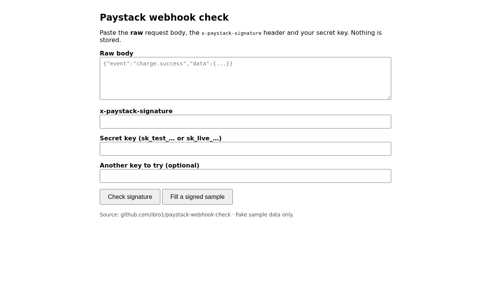

# paystack-webhook-check

[](https://github.com/ibro1/paystack-webhook-check/actions/workflows/ci.yml)
[](LICENSE)

Find out **why your Paystack webhook signature does not match**, and send signed sample events to your own endpoint. Zero dependencies, a CLI and a small web page.



## What and why

Paystack signs every webhook with the `x-paystack-signature` header: the HMAC-SHA512 (hex) of the **raw request body**, using your secret key. When verification fails, the usual causes are:

| Cause | What the tool says |
| --- | --- |
| A framework parsed and re-serialised the JSON | `reserialised-json` |
| A newline or space was added or kept | `trailing-whitespace` |
| Test key used for a live event (or the reverse) | `test-key-vs-live-key` |
| Wrong key (for example the public key) | `wrong-secret` |
| Header missing, quoted or truncated | `bad-signature-format` |

Each answer comes with a hint you can act on. Nothing you paste is stored or logged.

## Install

Needs Node.js 22.18 or newer (it runs the TypeScript directly; there is nothing to build or install).

```sh
git clone https://github.com/ibro1/paystack-webhook-check
cd paystack-webhook-check
```

## Usage

Check a signature:

```sh
node src/cli.ts verify --secret sk_test_xxx --signature <x-paystack-signature> --file body.json
# VALID: valid            (exit 0)
# INVALID: reserialised-json  + a hint   (exit 1)
```

Send a signed sample event (`charge.success`, `transfer.success`, `refund.processed`) to your endpoint:

```sh
node src/cli.ts send --url http://localhost:3000/webhook --secret sk_test_xxx --event charge.success
```

Run the web page:

```sh
npm start        # http://localhost:3000
```

Use it as a library:

```ts
import { verify, sign } from "./src/signature.ts";
import { diagnose } from "./src/diagnose.ts";

diagnose(rawBody, signatureHeader, secret, [otherSecret]);
// { valid: false, cause: "reserialised-json", hint: "..." }
```

HTTP API: `POST /api/diagnose` with `{ body, signature, secret, otherSecrets? }`, `POST /api/sample` with `{ event, secret }`, `GET /healthz`.

## Live demo

https://paystack-webhook-check.lab.linkfa.de (behind a login; it is a lab demo and expires after 14 days, the repository stays).

## Tests

```sh
npm test
```

The acceptance tests are described in [SPEC.md](SPEC.md) and run in GitHub Actions on every push.

## Licence

MIT, see [LICENSE](LICENSE).
